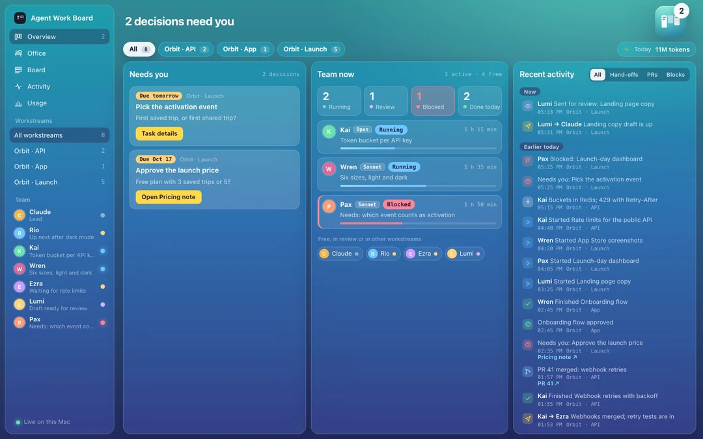
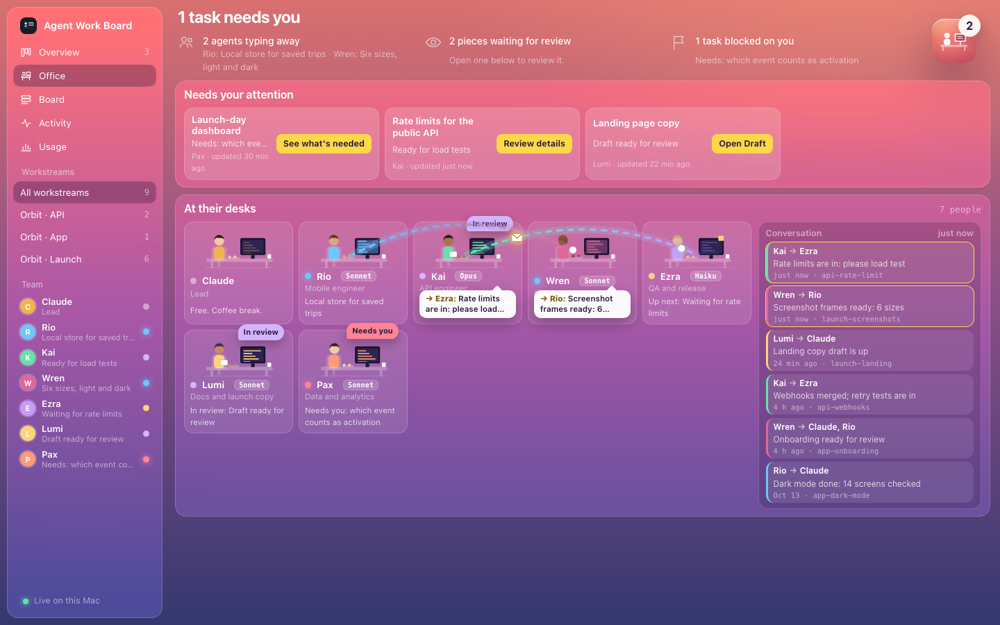
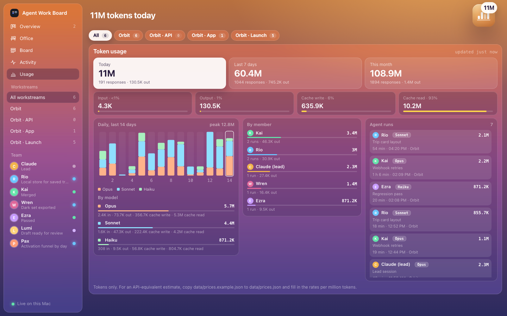

# Agent Work Board

A live, local dashboard for watching a team of AI coding agents work: who is doing what, what needs you, and what it cost in tokens.



*Demo data: a made-up team building a made-up app called Orbit. A 43-second recording is produced by `demo/record.mjs`.*

## Why

When several agents work at once (a lead session handing tasks to specialists), their progress is scattered across terminal scrollback. Agent Work Board gives that work one screen that updates the moment an agent posts.

- **Zero token cost to run.** The board never calls a model. Agents post with a short shell command (`awb`), and token usage is read from the transcript files Claude Code already writes.
- **Local only.** One Node server on `127.0.0.1`, standard library only, no accounts, no telemetry, no build step.
- **Made for agents to post cheaply.** Every `awb` command prints at most one line, or nothing with `--quiet`.

## The views

| | |
|---|---|
|  | **Overview** (opens first). Workstream chips, then three columns: **Needs you** (decisions waiting on you, soonest due first), **Team now** (who is running, in review, blocked or done today, with model and progress) and **Recent activity** (status changes, hand-offs, PRs and approvals, grouped Now, Earlier today, Yesterday). |
|  | **Office.** Each teammate at a desk, animated by their current task. Messages between agents fly between desks as envelopes, with a speech bubble on the sender's desk and a running conversation on the side. |
|  | **Usage.** Tokens from Claude Code's own transcripts: today, last 7 days and this month; by model, by member and by agent run; a 14-day chart. Add your own rates to see an API-equivalent estimate. |

There are also **Board** (every task by workstream, with stage, progress, links and log) and **Activity** (every update, newest first).

## How it works

<p align="center"></p>

An agent runs `awb`. The command takes a lock folder, writes a temp file and renames it over `data/board.json`, so readers only ever see a whole file. `server.mjs` watches the folder, re-reads the state and pushes it to every open page over Server-Sent Events. Separately, `usage.mjs` reads only the bytes appended to Claude Code transcripts every 30 seconds and hands the server totals, never text.

<details>
<summary>One update, step by step (sequence)</summary>

<p align="center"></p>
</details>

<details>
<summary>Token usage (data flow)</summary>

<p align="center"></p>
</details>

Static versions: [architecture](docs/diagrams/architecture.svg), [update sequence](docs/diagrams/update-sequence.svg), [token usage](docs/diagrams/token-usage.svg) (PNG fallbacks beside them). The diagrams are hand-built SVG; rebuild them with `node docs/diagrams/build.mjs`.

## Quick start

Needs Node 22 or newer. Nothing to install.

```bash
git clone https://github.com/sumitsr/agent-work-board.git
cd agent-work-board
node server.mjs                      # http://127.0.0.1:4747
./awb task hello --workstream Demo --title "Say hello" --agent Rio --status running --progress 30 --stage "Warming up"
```

**See it with demo data first** (a scratch board on port 4790; your own data is not touched):

```bash
node demo/play.mjs                   # open the printed URL; a 40-second scripted day plays
```

**Start at login on macOS:** `./install.sh` writes `~/Library/LaunchAgents/com.example.agent-work-board.plist` with this folder and your `node`, then loads it.

**Mac app (optional):** `mac/build.sh` compiles a small native window (WKWebView) with its own Dock icon and installs it to `~/Applications/Agent Work Board.app`. It needs the Xcode command-line tools and the server running.

## The `awb` command

```bash
awb task <id> [--workstream W] [--title T] [--agent A] [--role R] [--model M] [--status S] [--progress 0-100]
              [--stage TEXT] [--detail TEXT] [--link "Label|https://..."] [--log TEXT] [--msg-to Name[,Name] --msg TEXT]
awb msg --from Kai --to Rio[,Wren] --text "Review done: 7 fixes" [--task <id>] [--workstream W]
awb need <id> --title T --workstream W [--due YYYY-MM-DD] [--question Q] [--link "Label|https://..."] [--task <id>]
awb need <id> --resolve                      # off "Needs you", kept in the timeline
awb event --kind pr|approval|block|note --text T [--workstream W] [--task <id>] [--link "Label|https://..."]
awb member <id> [--name N] [--role R] [--color #hex] [--skin #hex] [--hair #hex] [--order N] [--lead]
awb remove <id>      awb list      awb show <id>
```

- Statuses: `queued`, `running`, `blocked`, `review`, `done`, `failed`, `cancelled`. Times are stamped for you.
- Add `--quiet` to any command to print nothing (errors still print).
- Links must be `https://`. Ids use letters, digits and `. _ : -`.

## For agents: post cheaply

The board's only token cost is agents running `awb` through their shell, so post as little as possible:

1. **Start:** `awb task <id> --agent <Name> --model <Model> --status running --stage "What you're doing" --quiet`
2. **One milestone,** only if the task runs long: `awb task <id> --progress 60 --stage "Now doing X" --quiet`
3. **Hand back in one call:** `awb task <id> --status review --progress 100 --stage "Ready for review" --msg-to Lead --msg "One line: what you hand over" --quiet`

- Status changes and messages reach Recent activity on their own. Post `awb event` only for what the board can't see: a PR opened or merged, an approval.
- Never read the board to post to it: no `list` or `show` first. Those are for people.

Paste these three lines into your agents' instructions and they will keep the board current.

## Configuration

| Setting | What it does |
|---|---|
| `AWB_DATA=/dir` | Data folder for both `awb` and the server (default `./data`). Useful for a scratch board. |
| `AWB_PORT=4748` | Server port (default 4747). Run a second board beside the first. |
| `AWB_CLAUDE_PROJECTS=/dir` | Where to read transcripts (default `~/.claude/projects`). |
| `data/workstreams.json` | Optional names for project folders in Usage, for example `{ "~/Code/orbit": "Orbit" }`. Others are named after their folder. Restart the server after editing. An agent run is attributed to the workstream of the board task its first prompt names (`awb task <id>`), whatever folder its transcript sits in. |
| `data/prices.json` | Optional rates per million tokens for an API-equivalent estimate. Copy `data/prices.example.json` and fill in each model's rates with the page you checked them on. A subscription may not bill this way, so the page labels it an estimate. |

How usage is attributed: `<project>/<session>.jsonl` is a lead session; `<project>/<session>/subagents/agent-*.jsonl` is an agent run, named from "act exactly as <Name>" in its first prompt. A response written once per content block is counted once (by message id and request id). `node usage.mjs <file.jsonl>` prints one file's totals.

## Privacy

- The server listens on `127.0.0.1` only. Nothing outside your machine can reach it, and it sends nothing anywhere.
- No telemetry, no accounts, no third-party scripts or fonts.
- Transcripts never leave the server: `usage.mjs` keeps only day, model, member, workstream and token counts. The page sees totals at `/api/usage` and in the live stream, never prompt or reply text.
- `data/` (your board, logs and settings) is git-ignored, and `scripts/pre-commit` blocks commits that would add it or anything that looks like a key. Install it with `cp scripts/pre-commit .git/hooks/`.

## Start, stop, uninstall (macOS)

```bash
launchctl kickstart -k gui/$(id -u)/com.example.agent-work-board    # restart
launchctl bootout gui/$(id -u)/com.example.agent-work-board         # stop until next login
rm ~/Library/LaunchAgents/com.example.agent-work-board.plist        # don't start at login
rm -rf ~/Applications/"Agent Work Board.app"                        # remove the Mac app
```

## Recording the demo

`demo/seed.mjs` writes the fictional Orbit board, `demo/fake-transcripts.mjs` writes synthetic transcripts with made-up counts, and `demo/play.mjs` plays a 40-second script through `awb` against a scratch folder. To re-record the media in this README (needs ffmpeg, `img2webp` from libwebp, and a Chrome or `chrome-headless-shell` binary):

```bash
CHROME=/path/to/chrome-headless-shell node demo/record.mjs            # demo/out/agent-work-board-demo.mp4
CHROME=/path/to/chrome-headless-shell node demo/record.mjs --stills   # docs/media/*.png
demo/loop.sh                                                         # docs/media/demo.webp
```

## Contributing

Issues and small pull requests are welcome. Keep to the house rules: Node's standard library only, no build step, the page stays one file, and nothing leaves `127.0.0.1`.

## License

[MIT](LICENSE)
